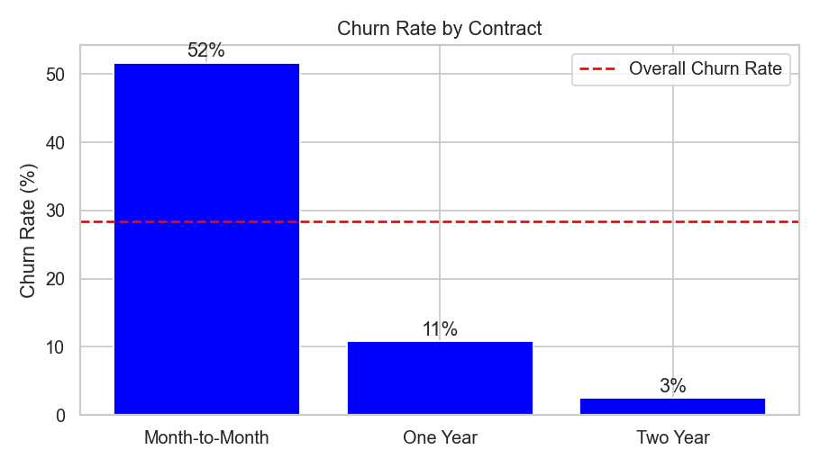
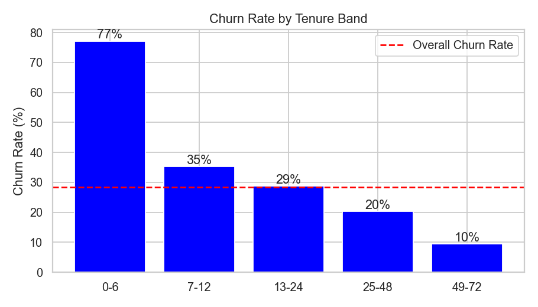
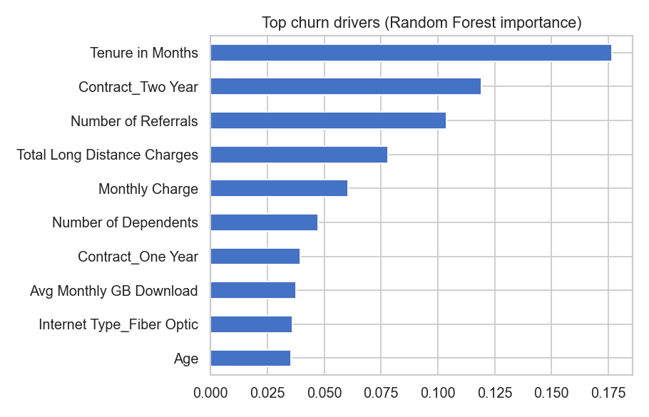

# Telecom Customer Churn Analysis

End-to-end analysis of why telecom customers leave, who is likely to leave next, and what the company should do about it. Built with Python (pandas, seaborn, scikit-learn) and Power BI.

## Headline results
- **28.4%** of customers churned (1,869 of 6,589, excluding customers who just joined).
- Churned customers were paying about **$137K per month** and had generated **$3.68M** in lifetime revenue.
- **55%** of churners left within their first 12 months.
- A Random Forest model predicts churn with **ROC-AUC 0.93** and flags **548 currently active customers** as high risk (about $28.7K monthly revenue).

## Business questions
1. How many customers are we losing and what does it cost?
2. Who leaves, when, and why?
3. Can we predict who will leave next?
4. What should the company do?

## Data
Maven Analytics telecom churn dataset (California, Q2 2022): customer churn table (7,043 customers, 38 columns), zip code population, data dictionary. Raw files are in `data/raw/`.

## Approach
1. Loaded and merged the three files (checked no rows were lost).
2. Data quality checks: no duplicates; blanks were structural (no internet, no phone, no offer) and filled with meaningful labels; 120 negative monthly charges flagged.
3. Excluded "Joined" customers from churn analysis (new customers, no chance to churn yet).
4. Feature engineering: tenure bands, age bands, add-on count.
5. EDA: churn rate against every customer attribute, correlation, contract x internet heatmap, churn reasons, San Diego deep-dive.
6. Modelling: Random Forest on one-hot encoded features; leakage fields (churn category/reason) excluded.
7. Scored active customers into Low / Medium / High risk.
8. Built a 4-page Power BI dashboard from the cleaned export.

## Key findings
| Driver | Finding |
|---|---|
| Contract | Month-to-month 52% churn vs 11% (1 year) and 3% (2 year); 89% of churners are month-to-month |
| Tenure | 77% churn in the first 6 months, under 10% after 4 years |
| Internet | Fiber Optic 42% vs DSL 20%; fiber + month-to-month is worst at 62% |
| Offers | Offer E customers churn at 68%; Offers A and B at 7% and 12% |
| Location | San Diego 66% churn vs about 27% elsewhere; 82% of leavers cite a competitor |
| Add-ons | Without Online Security / Tech Support about 45% churn vs about 15% with |
| Reasons | Competitors 45%, support attitude 17%, dissatisfaction 17%, price 11% |





## Model
Random Forest (300 trees), 75/25 stratified train/test split.

| Metric | Value |
|---|---|
| Test ROC-AUC | 0.925 |
| Churner recall (threshold 0.5) | 76% |
| Churner precision (threshold 0.5) | 72% |

Top predictors: tenure, contract type, number of referrals, monthly charge, dependents.

## Dashboard
Built in Power BI from `data/processed/churn_clean.csv`. Build steps and DAX measures are in `dashboard/POWER_BI_GUIDE.md`.


## Recommendations
1. Move month-to-month customers to 1-2 year contracts, starting with first-year customers.
2. Run a 6-month onboarding and check-in programme.
3. Redesign or retire Offer E; model new offers on A and B.
4. Launch a competitive response in San Diego.
5. Bundle Online Security and Tech Support on fiber plans for a trial period.
6. Use the High-risk list for proactive retention calls; train support staff on service attitude.
7. Encourage credit card / autopay over bank withdrawal and mailed check.

## Project structure
```
data/raw/          original CSVs
data/processed/    cleaned export used by the dashboard
notebooks/         churn_analysis.ipynb (full analysis)
images/            charts used in this README
dashboard/         Power BI file and build guide
```

## How to run
```bash
git clone https://github.com/piyuushsharrma/telecom-churn-analysis.git
cd telecom-churn-analysis
pip install -r requirements.txt
jupyter notebook notebooks/churn_analysis.ipynb
```

## Limitations and next steps
Single quarter of data, so no time trend; the referral field has an unexplained spike at 1 referral that should be checked with the data owner; next steps would be a cost-benefit model for retention offers and monitoring the model each quarter.
